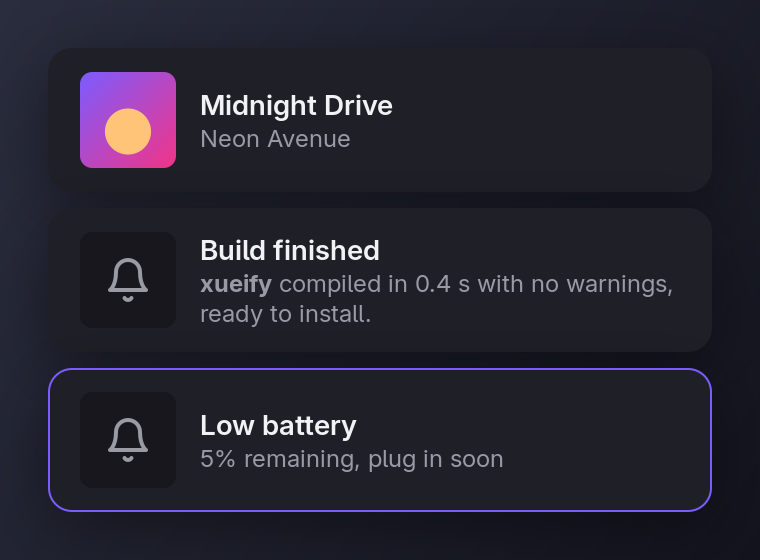

# xueify

[](https://github.com/ouxan/xueify/actions/workflows/build.yml)
[](LICENSE)

A small, good-looking notification daemon for Wayland, written in C.

xueify shows desktop notifications as dark rounded cards in the bottom-right
corner of the screen. It's designed to cost nothing while idle: no timers, no
polling and no buffers until a notification arrives.

<p align="center">
  
</p>

## Features

- **Spec-compliant**: implements the
  [Desktop Notifications Specification](https://specifications.freedesktop.org/notification-spec/latest/) 1.2,
  so `notify-send`, browsers, chat apps and anything using libnotify just work.
- **Cover art and icons**: `image-data`, `image-path` and `app_icon` are cropped to a
  rounded square; notifications without an image get a bell.
- **Readable text**: a one-line title and up to two lines of body, with `<b>`, `<i>`
  and `<u>` markup and a plain-text fallback.
- **Stacking**: up to five cards at once, newest at the bottom; the rest wait in a queue.
- **In-place updates**: `replaces_id` and the `x-canonical-private-synchronous` /
  `x-dunst-stack-tag` hints update an existing card instead of adding one, which is
  ideal for volume and brightness popups.
- **Mouse**: hover pauses the timeout; left click runs the default action, right
  click dismisses and middle click clears everything.
- **Critical notifications** get an accent border and stay until dismissed.
- **HiDPI**: renders at the scale the compositor prefers.

## Resource use

Measured on Arch Linux with Hyprland, x86-64:

| | |
|---|---|
| Binary size | ~80 KB |
| Private memory while idle | ~5 MB (PSS ~7 MB; the rest is shared libraries) |
| Wakeups while idle | 0. The process sleeps in a single `poll()` |
| CPU per notification | One draw. Slide animations are left to the compositor |

Each card is drawn once into a shared-memory buffer, which is unmapped
straight away and released when the compositor is done with it.

## Requirements

- A Wayland compositor with `zwlr_layer_shell_v1`: Hyprland, Sway, river, niri, labwc, Wayfire and others.
- Runtime: `wayland`, `cairo`, `pango`, `gdk-pixbuf2`, `glib2`, `libsystemd` (sd-bus).
- Build: a C11 compiler, `make`, `pkg-config`, `wayland-scanner`,
  `wayland-protocols`, `wlr-protocols`.
- Optional: `librsvg` for SVG icons, and the *Adwaita Sans* font (`adwaita-fonts`)
  for the intended look. Any other font works too.

On Arch Linux:

```sh
sudo pacman -S --needed base-devel wayland wayland-protocols wlr-protocols cairo pango gdk-pixbuf2
```

## Installation

### Arch Linux

A PKGBUILD lives in [`packaging/arch`](packaging/arch/PKGBUILD):

```sh
git clone https://github.com/ouxan/xueify.git
cd xueify/packaging/arch
makepkg -si
```

### From source

```sh
git clone https://github.com/ouxan/xueify.git
cd xueify
make
sudo make install                  # into /usr/local
# or, without root:
make install PREFIX="$HOME/.local"
```

This installs the binary, a D-Bus activation file, a systemd user unit
(`xueify.service`) and the `xueify(1)` man page. `make uninstall` with the same
`PREFIX` removes them again.

## Running

Only one notification daemon can own `org.freedesktop.Notifications`, so stop
the one you use now (dunst, mako, swaync, …) first.

**Start it with your session.** Add this to your compositor's autostart:

```sh
systemctl --user start xueify.service
```

If your session activates `graphical-session.target` (for example through
uwsm), you can run `systemctl --user enable xueify.service` instead.

The unit restarts xueify if it ever crashes. On top of that, the D-Bus
activation file starts xueify on demand when the first notification is sent.

> **Note:** dbus-broker only reads activation files at startup. After installing,
> run
> `busctl --user call org.freedesktop.DBus /org/freedesktop/DBus org.freedesktop.DBus ReloadConfig`
> or log out and back in. When another daemon also ships an activation file, the
> one in the earlier data directory wins (`~/.local/share` comes before `/usr/local/share`,
> which comes before `/usr/share`).

### Hyprland

Layer surfaces use the namespace `xueify`. To make cards slide in from the
right, add a layer rule. With the Lua configuration:

```lua
hl.layer_rule({
    name      = "xueify",
    match     = { namespace = "^xueify$" },
    animation = "slide right",
})
```

## Trying it out

```sh
notify-send "Hello" "This is <b>xueify</b>"
notify-send -i firefox "Download finished" "archive.tar.zst"
notify-send -u critical "Low battery" "5% remaining"
notify-send -h string:image-path:/path/to/cover.png "Song title" "Artist"
notify-send -A default=Open "Click me" "Left click runs the default action"

# Update a card in place
id=$(notify-send -p "Volume" "10%"); notify-send -r "$id" "Volume" "60%"
```

## Customisation

xueify has no configuration file. Size, spacing, colours, font, timeout and the
number of visible cards are compile-time constants at the top of
[`src/xueify.h`](src/xueify.h). Edit them and run `make install` again.

`ICON_RULES` in the same file swaps the sender's icon when the app name or the
summary starts with a given prefix. The replacement can be a file path, a themed
icon name or a built-in drawing. Images sent with the notification still take
precedence. The default rule draws Claude Code's pixel mascot (`@clawd`) for
notifications from Claude Code, which usually arrive through the terminal with
the terminal's own icon.

`make preview` renders sample cards with the real drawing code into
`docs/preview.png`, so you can check a change without sending notifications.

## Specification coverage

| | |
|---|---|
| Capabilities | `body`, `body-markup`, `actions`, `icon-static` |
| Hints | `urgency`, `image-data` / `image_data` / `icon_data`, `image-path` / `image_path`, `x-canonical-private-synchronous`, `synchronous`, `x-dunst-stack-tag` |
| Actions | `default` is invoked on left click; other actions are accepted but not shown as buttons |
| Close reasons | expired (1), dismissed (2), `CloseNotification` (3) |
| Timeout | the sender's value; `-1` means 5 s; `0` and critical urgency mean never |

## Project layout

```
src/main.c      event loop: Wayland, D-Bus and one timerfd in poll()
src/dbus.c      org.freedesktop.Notifications server (sd-bus)
src/wl.c        layer-shell surfaces, shm buffers, pointer input
src/render.c    card drawing with cairo and pango, image loading
src/notif.c     notification list, stacking, timeouts
tools/preview.c renders docs/preview.png
data/           D-Bus activation file and systemd user unit templates
docs/           man page and preview image
```

## License

[MIT](LICENSE). The placeholder bell is traced from [Lucide](https://lucide.dev)
(ISC); see [THIRD_PARTY_NOTICES.md](THIRD_PARTY_NOTICES.md).
